<div align="center">

<a href="https://www.usebrix.app">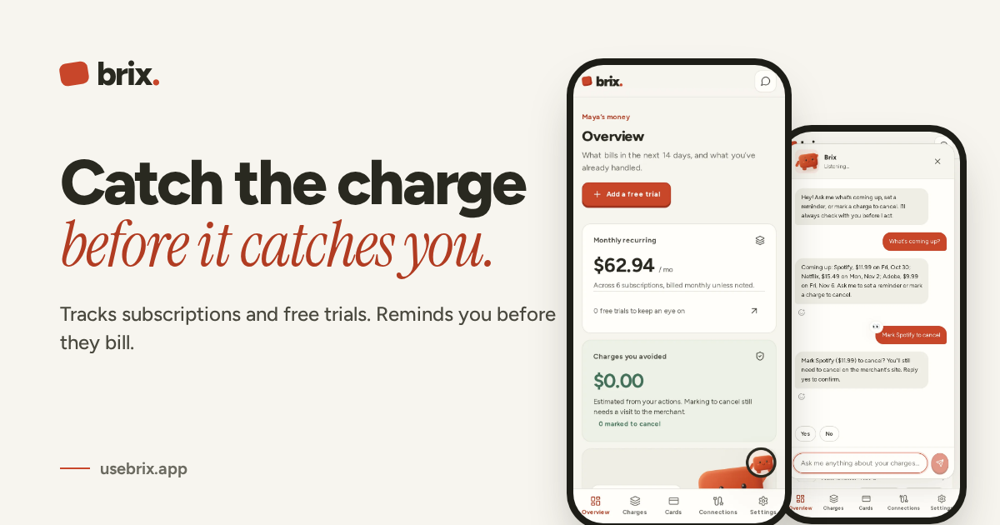</a>

# Brix

### Catch money moments before they pass.

An AI money assistant for college students. Brix spots the moments students most often get money wrong: a free trial about to bill, borrowed money hidden in an aid refund, a gift card about to expire, a first investment. For each one it gives a single clear next step, in the app, on WhatsApp or over a phone call.

[](https://www.usebrix.app)
[](https://www.usebrix.app/developers)
[](https://hackpsu.org)


**Built for the FNB Challenge: Trust, Decisions & Financial Confidence**

[Try it](#try-it-in-60-seconds) · [The problem](#the-problem) · [What Brix does](#what-brix-does) · [How it works](#how-it-works) · [Trust](#trust-by-design) · [API](#developer-api) · [Run it](#run-it-locally)

</div>

---

## Try it in 60 seconds

| Channel | How |
|---|---|
| 🌐 **Web app** | Open **[usebrix.app](https://www.usebrix.app)** and sign in with Google. Link the Plaid sandbox bank with `user_good` / `pass_good`. |
| 📞 **Phone call** | Call **+1 (870) 395-8999**. Brix answers, reads your charges and proposes actions you confirm in the app. |
| 💬 **WhatsApp** | Send `join frozen-partly` to **+1 (415) 523-8886** (Twilio sandbox), then ask *"what's coming up?"* |
| 🧑‍💻 **API** | Create a key on the Developers page in the app, then `curl https://www.usebrix.app/api/v1/me -H "Authorization: Bearer $BRIX_API_KEY"` |

> [!NOTE]
> Bank data is Plaid **sandbox** data and cards are Lithic **sandbox** cards. No real money moves anywhere in Brix, by design.

---

## The problem

Students rarely lose money in one big mistake. They lose it at small moments nobody warns them about. The information already exists in bank statements and award letters. Nobody turns it into a decision **at the moment it matters**.

| Moment | The data | Source |
|---|---|---|
| 🔔 **Forgotten trials** | **48%** of Americans paid for a trial they forgot to cancel. **59%** of Gen Z. | 2024 U.S. survey (via 9to5Mac) |
| 🎁 **Unspent gift cards** | **$27B** sits unspent on U.S. gift cards. **43%** of adults hold at least one. | Bankrate, 2023–2024 |
| 🎓 **Hidden loans** | **28%** of first-year students with federal loans said they had none. | Akers & Chingos, Brookings |
| 📈 **Who to trust** | **48%** of Gen Z investors learned investing from social media. | FINRA Foundation & CFA Institute, 2023 |

FNB asks how technology can turn **information → understanding → confidence → action**. Brix does that at four specific, high-stakes moments in a student's money life.

---

## What Brix does

<table>
<tr>
<td width="50%" valign="top">

### 1 · Before a charge hits
Links a bank (Plaid), finds every subscription and free trial, predicts the next charge date, and reaches out **7 days and 2 days before** each one: in the app, on WhatsApp or with a phone call. Keep it, mark it to cancel (with the merchant's cancel link), set a reminder, or create a **single-use card** with a hard limit so a trial can never bill you.

</td>
<td width="50%">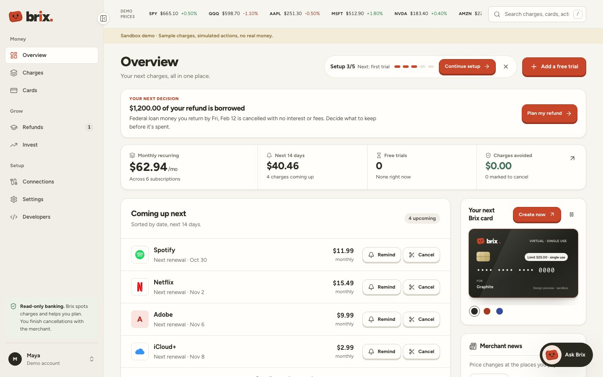</td>
</tr>
<tr>
<td width="50%">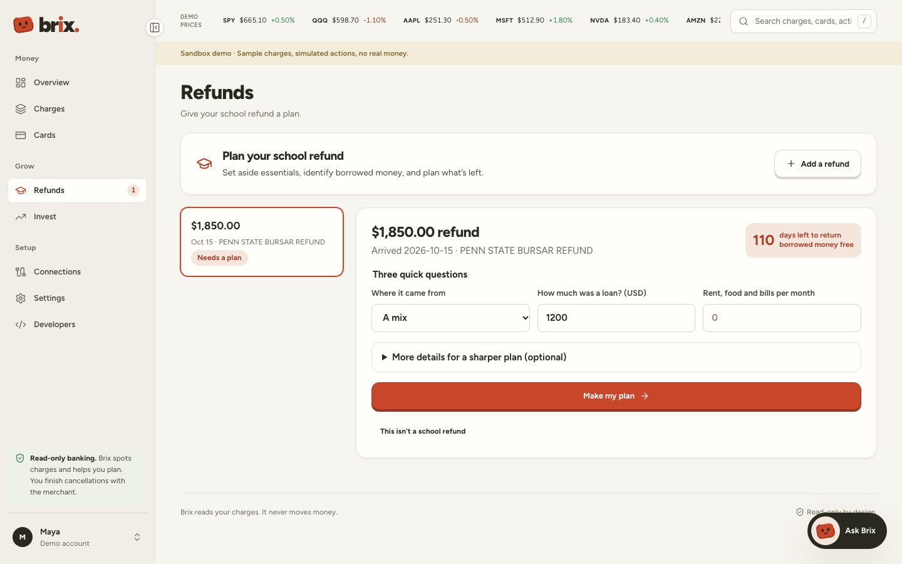</td>
<td width="50%" valign="top">

### 2 · When a school refund lands
Brix detects the aid refund deposit and points out what most students miss: **part of it may be borrowed**. Federal loan money returned within **120 days** is cancelled with no interest or fees. Brix shows the exact return-by date, the interest you'd otherwise pay, and a plan: essentials, an emergency buffer, then saving. It also flags when scholarship money may be **taxable**, with citations to studentaid.gov and IRS Publication 970.

</td>
</tr>
<tr>
<td width="50%" valign="top">

### 3 · Before a gift card expires
Add a gift card by filling in a gift card. Brix tracks balances and expiry dates, reminds you **14 and 3 days** before a card expires, and when you ask about a store you're about to pay, reminds you to use the card first. One-time cards are edited the same way, on a real Brix card with templates such as *Free trial · $1*.

</td>
<td width="50%">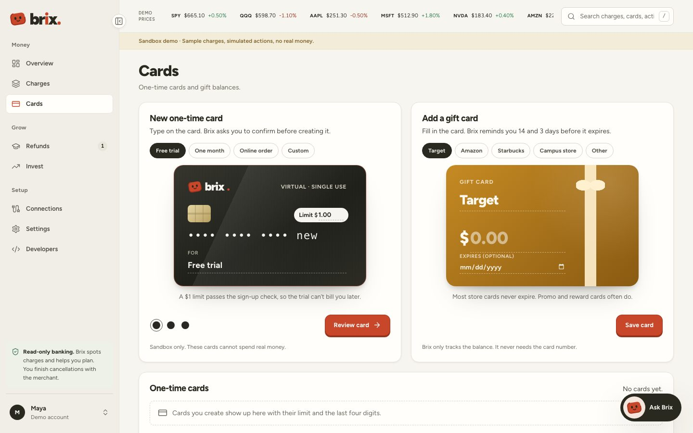</td>
</tr>
<tr>
<td width="50%">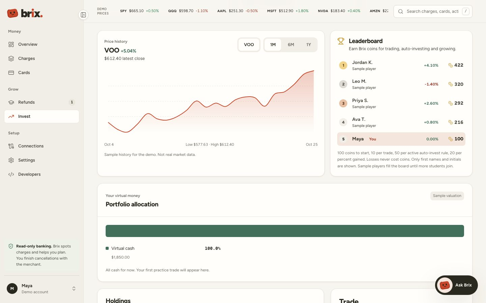</td>
<td width="50%" valign="top">

### 4 · Before you risk real money
A **practice portfolio** with virtual money at **real Yahoo Finance prices**. Buy fractional shares, set stop-loss and take-profit, schedule auto-invest, compare yourself with the S&P 500, and climb a **leaderboard of Brix coins** that rewards habits (trading, auto-investing) more than luck. Orders never fill without a real price.

</td>
</tr>
</table>

**One decision at a time.** The dashboard opens with the single most important decision right now, such as *"$1,200 of your refund is borrowed. Return it by Feb 12"*, instead of a wall of numbers.

**One assistant, everywhere.** The web chat, WhatsApp and phone calls all share **13 tools** that read the student's own data. Every answer is labelled with where it came from.

<p align="center">
  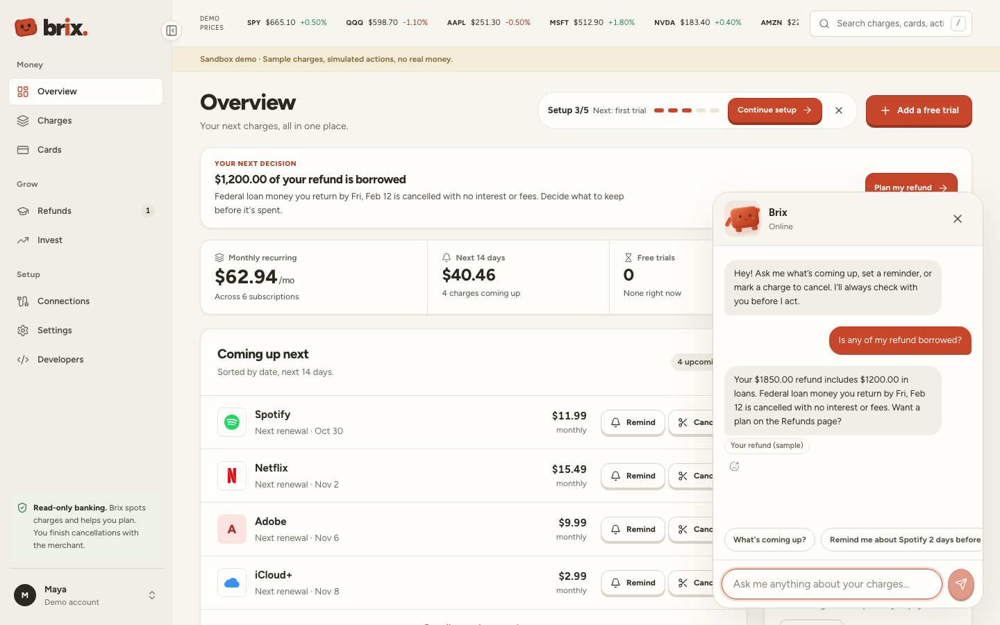
</p>

<p align="center">
  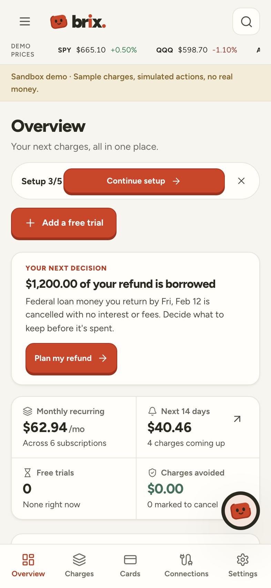
  &nbsp;
  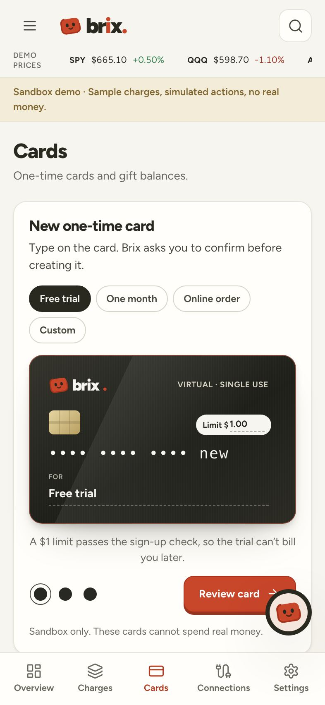
  &nbsp;
  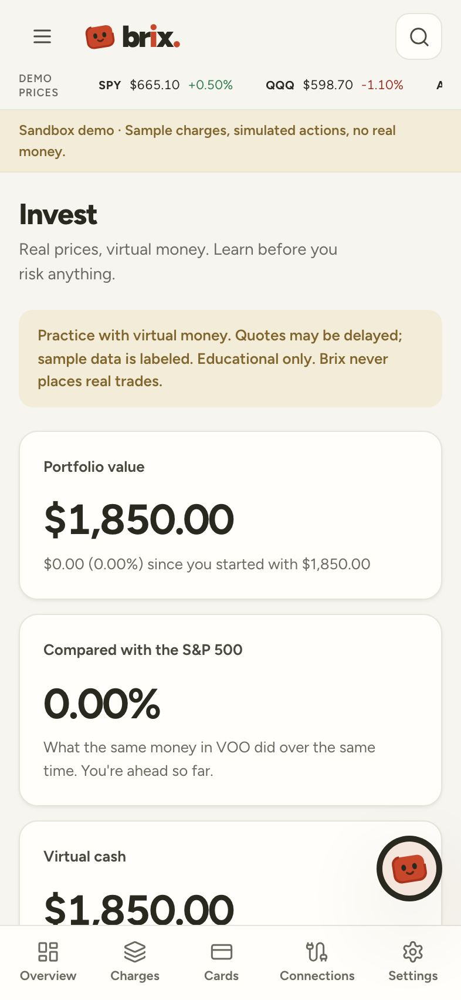
</p>
<p align="center"><sub>Fully responsive from 360px phones to 1920px desktops, with a bottom tab bar on mobile.</sub></p>

---

## How it works

### The journey: information → understanding → confidence → action

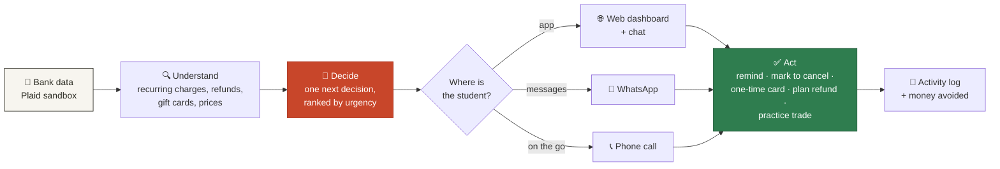

### System architecture: one brain, three channels

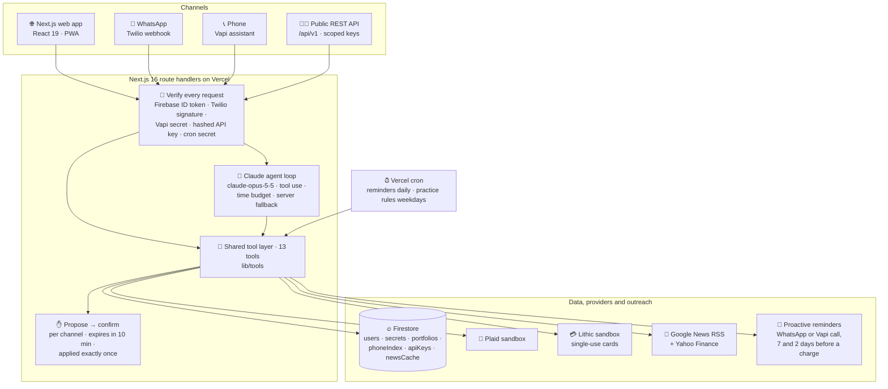

**Key decision: one tool layer.** Every capability (read charges, set a reminder, mark to cancel, create a card, plan a refund, place a practice trade, read news) is one TypeScript function in [`lib/tools`](lib/tools). Claude calls it from web and WhatsApp, Vapi calls it over HTTP from a phone call, and the UI and public API call it through routes. One implementation and one set of safety rules for every channel.

### Every action waits for your yes

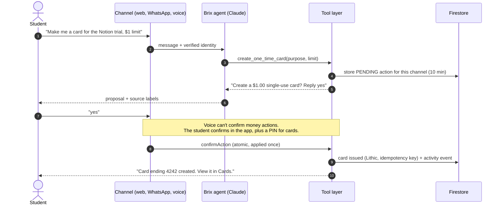

### The refund planner

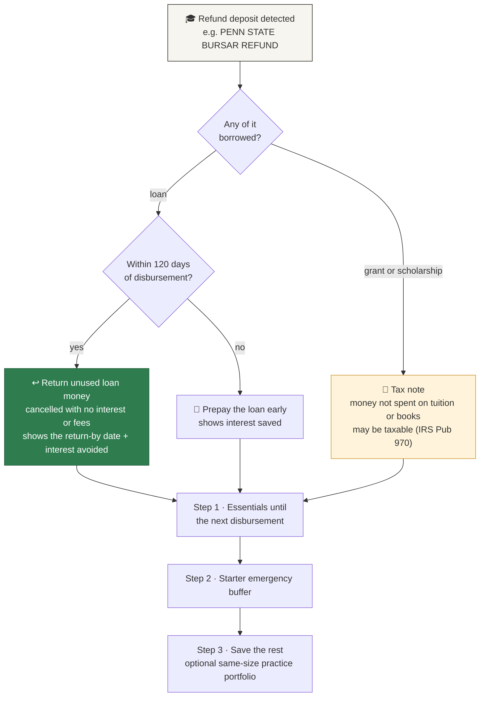

Every figure is computed by code from the student's inputs and labelled as an estimate. Brix never assumes a loan rate; the student enters it.

---

## Trust by design

Trust is the FNB brief, so it is built into the architecture rather than added later.

| Principle | How Brix enforces it |
|---|---|
| 🔒 **Never moves money** | Read-only Plaid access. Brix never cancels at a merchant; it records your decision and hands you the cancel link. Investing is practice-only. |
| ✋ **Confirm before acting** | The AI can only *propose*. Proposals are stored per channel, expire after 10 minutes and are applied **exactly once**, even if two confirmations arrive at the same instant (tested). |
| 📞 **Voice can't spend** | A spoken "yes" never applies a change. Card creation from a call needs in-app confirmation **plus a 4-digit PIN** (hashed, and locked for 15 minutes after 5 wrong tries). |
| 🔢 **No invented numbers** | Amounts and dates come from code, never the model. The system prompt forbids personal investment advice. |
| 🏷️ **Every answer cites its source** | Replies carry labels like *Your charges*, *Brix's math (estimate)*, *News: Google News* or *General info, not your data*. Demo data is always marked *(sample)*. |
| 🛡️ **Every request verified** | Firebase ID tokens, Twilio signatures, a Vapi shared secret, a cron secret and SHA-256-hashed, scoped API keys. Firestore rules deny all client writes and every read of secrets. |
| 🧑‍⚖️ **You stay in control** | Full activity log, a bank-disconnect button, revocable API keys and a complete **delete my data** that also removes your bank link and portfolio (verified by the live test). |
| 👀 **Privacy** | Raw transactions are never stored, only detected charges and refunds. The leaderboard shows first names and initials only. |

---

## Why Brix fits the FNB criteria

| FNB asks | Brix shows it with |
|---|---|
| **Information → understanding** | Recurring charges, refunds and gift cards explained in one plain line each |
| **Understanding → confidence** | One "next decision" card, a 14-day timeline, a 120-day refund countdown, practice before real risk |
| **Confidence → action** | One tap, one WhatsApp reply or one phone call to remind, cancel, protect a trial or plan a refund |
| **Moments that matter most** | Reminders 7 and 2 days before a charge, 14 and 3 days before a gift card expires, and as soon as a refund lands |
| **Knowing what to trust** | Source labels on every answer, confirm-before-act, read-only data, no advice, an audit trail |
| **AI, personalization, prediction, automation** | A Claude tool-use agent on the student's own data, next-charge prediction, auto-invest rules, scheduled reminders |

---

## Feature checklist

- [x] Google sign-in, Google One Tap and phone verification (Firebase Auth)
- [x] Plaid sandbox link, transaction sync, recurring-charge detection and next-date prediction
- [x] Free-trial tracking, reminders, mark-to-cancel with merchant cancel links
- [x] Single-use virtual cards (Lithic sandbox) with templates and colours
- [x] Refund detection from bank deposits and a 120-day loan-return planner with tax notes
- [x] Gift card balances, expiry alerts and "use it first" nudges
- [x] Practice portfolio: live prices, fractional shares, stop-loss and take-profit, auto-invest, S&P 500 comparison, price-history chart, coins leaderboard
- [x] Merchant pricing news (Google News) and stock news (Yahoo Finance) with a shared cache and a stale-data fallback
- [x] Claude assistant across web, WhatsApp and phone (Vapi), with source labels on every answer
- [x] Proactive reminders by WhatsApp and outbound phone call (daily cron)
- [x] Public REST API v1 with scoped keys, rate limits, an OpenAPI 3.1 spec and generated docs
- [x] Accessible (axe checks pass on every main screen), responsive, respects reduced motion

---

## Developer API

Brix is also a small platform. Students and other apps can pull Brix data into spreadsheets, Discord bots or dashboards using keys the student creates and revokes.

```bash
curl https://www.usebrix.app/api/v1/charges/upcoming?days=14 \
  -H "Authorization: Bearer $BRIX_API_KEY"
```

| Scope | Grants |
|---|---|
| `charges:read` / `charges:write` | Charges, upcoming charges and the summary; add trials, mark to cancel |
| `reminders:read` / `reminders:write` | List, create and delete reminders |
| `cards:read` | Single-use cards, masked (never card numbers) |
| `news:read` | Pricing news about your merchants |
| `refunds:read` | School refunds and their plans |
| `practice:read` | The practice portfolio: value, positions, rules and orders |

<p align="center">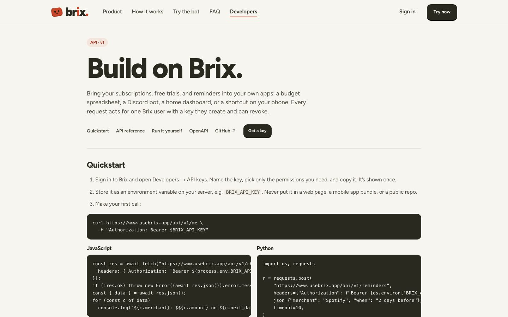</p>

Keys are SHA-256 hashed at rest, shown once, limited to 5 per user and 120 requests per minute. Trial creation is idempotent. Full reference: **[usebrix.app/developers](https://www.usebrix.app/developers)** · [docs/API.md](docs/API.md) · [`/api/v1/openapi.json`](https://www.usebrix.app/api/v1/openapi.json)

---

## Tech stack

| Layer | Choice |
|---|---|
| App | **Next.js 16** (App Router, route groups, persistent app shell), **React 19**, **TypeScript** |
| AI | **Claude Opus 5.5** via the Anthropic SDK: a manual tool-use loop with per-channel time budgets (12s WhatsApp, 10s otherwise) and a server-side fallback model |
| Identity and data | **Firebase Auth** (Google, One Tap, phone) and **Firestore** through the Admin SDK |
| Banking | **Plaid** sandbox (`/transactions/sync`, recurring streams) |
| Cards | **Lithic** sandbox `SINGLE_USE` cards with idempotency keys |
| Voice | **Vapi** assistant on a Twilio number, with tools pointing at `/api/vapi/tools` |
| Messaging | **Twilio** WhatsApp, with signature-validated webhooks |
| Markets and news | **Yahoo Finance** quotes and history, **Google News RSS**, cached in Firestore |
| Hosting | **Vercel** with two cron jobs (reminders daily, practice rules on weekdays) |
| Quality | `node:test`, **Playwright** (desktop + mobile), **axe-core**, a live production smoke test |
| Design | Hand-written CSS design tokens, Figtree and Instrument Serif, Lucide icons, an SVG mascot with moods |

---

## Quality and testing

| Suite | What it covers | Result |
|---|---|---|
| **Unit** (`npm test`) | Recurring detection, refund classifier and planner maths, the order engine, the confirmation model, RSS parsing, quotes and history parsing, leaderboard scoring, API keys | **71 / 71 passing** |
| **Browser** (`npm run test:e2e`) | Every screen on desktop and mobile, the chat, cards, refunds, practice, the API, keyboard shortcuts, accessibility scans, horizontal-overflow checks | **150+ passing** |
| **Live smoke** (`scripts/smoke-live.mts`) | 44 steps against **production** with a throwaway account: Plaid sync, refund detection, Claude replies with sources, Lithic, signed WhatsApp and voice webhooks, live-price trades, price history, leaderboard, news, crons, then full data deletion | **44 / 44 passing** |

---

## Run it locally

Requires **Node 22+**. The local demo needs no API keys; it uses persistent sample data for "Maya", a college sophomore.

```bash
git clone https://github.com/Timeless-Dave/brix.git && cd brix
npm install
cp .env.example .env.local      # demo mode is on by default
npm run dev                     # http://localhost:3000
```

```bash
npm run lint && npm run typecheck
npm test                        # unit tests
npm run test:e2e                # production build + Playwright
npm run check:config            # which live integrations are configured (never prints secrets)
```

To connect real sandbox providers (Firebase, Plaid, Anthropic, Twilio, Vapi, Lithic), follow **[SETUP.md](SETUP.md)** and **[INTEGRATIONS.md](INTEGRATIONS.md)**.

> [!IMPORTANT]
> `BRIX_DEMO_MODE` and `NEXT_PUBLIC_BRIX_DEMO_MODE` must both be `false` in production. Demo mode refuses to turn on in a Vercel production deployment.

<details>
<summary><b>Project structure</b></summary>

```
brix/
├─ app/
│  ├─ page.tsx                    # Landing page
│  ├─ (workspace)/                # The signed-in app: one persistent shell
│  │  ├─ layout.tsx               #   renders the app shell once for every page
│  │  ├─ dashboard/ subscriptions/ cards/ refunds/ practice/
│  │  └─ connect/ settings/ developer/ admin/
│  ├─ developers/                 # Public API docs (generated from the OpenAPI spec)
│  ├─ onboarding/                 # Guided setup
│  └─ api/                        # 53 route handlers
│     ├─ agent/ whatsapp/ vapi/   #   the three assistant channels
│     ├─ plaid/ cards/ trials/ refunds/ gift-cards/ practice/ market/ news/
│     ├─ jobs/                    #   cron: reminders, practice rules
│     └─ v1/                      #   public REST API
├─ lib/
│  ├─ agent/                      # Claude loop, system prompt, tool schemas, moods, source labels
│  ├─ tools/                      # THE shared tool layer (web, WhatsApp, voice, API)
│  ├─ refunds/                    # detection + 120-day planner
│  ├─ practice/                   # order engine, rules, leaderboard
│  ├─ market/ news/               # quotes, history, RSS, cache
│  ├─ api/                        # API keys, scopes, OpenAPI spec
│  └─ store.ts                    # Firestore transactions (local files in demo mode)
├─ components/                    # App shell, sidebar, ticker, cards studio, practice, chat, brand
├─ tests/                         # unit tests + Playwright browser tests
├─ scripts/                       # live smoke test, config check, Vapi tool export, seeding
└─ docs/                          # API reference, Devpost write-up, pitch script, Vapi prompt
```

</details>

---

## Business model

| Stream | How it works |
|---|---|
| **Free core** | Bank link, charge detection, in-app reminders, refund planner, practice portfolio |
| **Brix Plus** (to validate) | WhatsApp and phone reminders, one-time cards, news briefings, at a student price |
| **Bank and credit-union white-label** | Banks such as FNB embed Brix's assistant in their own app to win and keep young customers |
| **Interchange** | A share of the card fee when Brix issues real one-time cards through a sponsor bank |
| **API** | Paid tiers for apps that build on Brix data, with each student's permission |

**Go-to-market:** one campus first (student orgs, orientation, financial-aid offices), then bank and credit-union partners near campuses.

## What's next

- Sponsor-bank partnership and compliance review, then real cards and production bank data
- A pilot inside a bank app (white-label)
- Hand-off from practice to low-cost brokers, without Brix ever holding money
- OAuth and webhooks for the API, so other student apps can build on Brix

---

<div align="center">


**Brix: your money, brick by brick.**

Built in 24 hours at **HackPSU Fall 2026** by **David Adedeji** and Team Brix.

[usebrix.app](https://www.usebrix.app) · [API docs](https://www.usebrix.app/developers) · [Devpost write-up](docs/DEVPOST.md)

</div>
